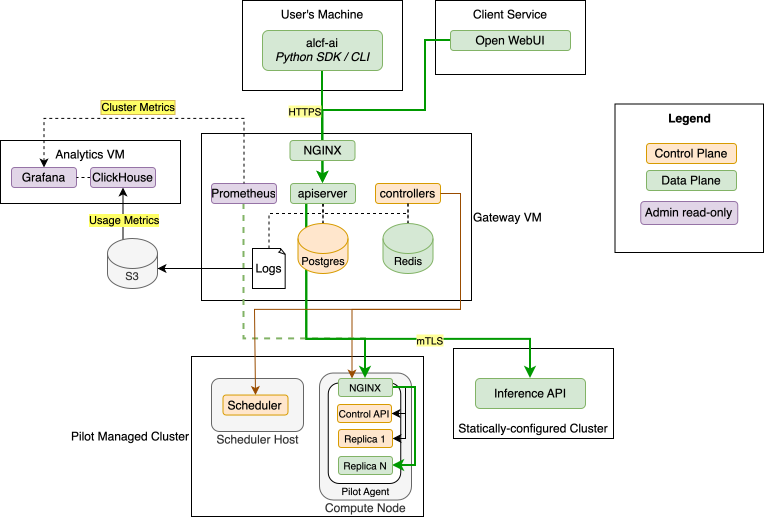
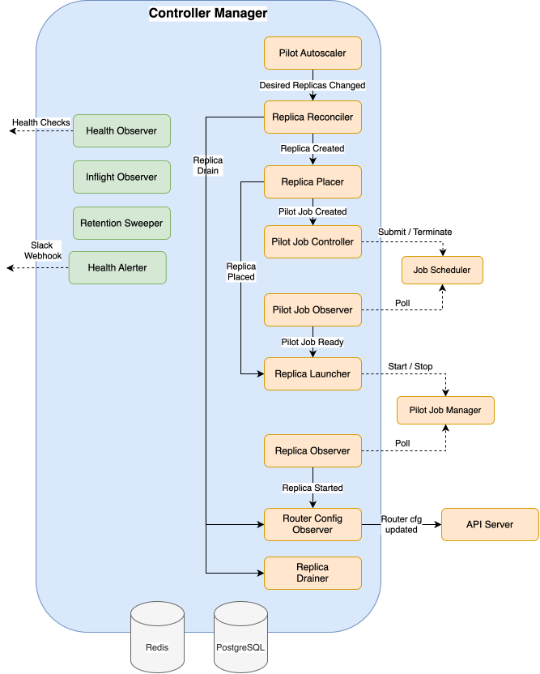
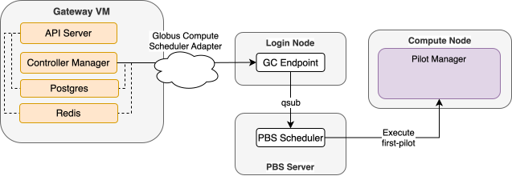
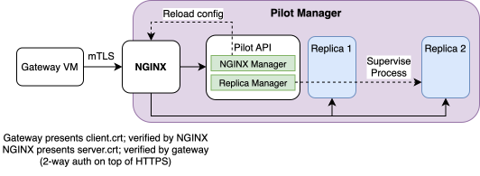

[](https://opensource.org/licenses/Apache-2.0)


# FIRST

FIRST (Federated Inference Resource Scheduling Toolkit) is a self-hosted Inference-as-a-Service platform for scientific computing facilities. It gives researchers cloud-like access to AI models running on a facility's own HPC and AI clusters, through [OpenAI](https://platform.openai.com/docs/overview)- and [Anthropic](https://platform.claude.com/docs/en/api/messages)-compatible APIs, with [Globus Auth](https://www.globus.org/globus-auth-service) identity and group-based access control. Sensitive data and custom models stay on-premises.

The **Inference Gateway** sits in front of inference engines spread across multiple, heterogeneous clusters. It owns authentication, authorization, quotas, request routing, federated load balancing, and the lifecycle of the models themselves.

## Architecture at a glance



**Green is the data plane**: the path an inference request takes, from the client through the gateway's API server to a model backend. **Orange is the control plane**: everything that configures, launches, scales, and health-checks models. Purple components are read-only views for admins.

Requests reach models in two kinds of clusters. In a **pilot-managed cluster**, the gateway's controllers submit pilot jobs through the batch scheduler and then start and stop model replicas inside them; inference traffic goes over mutual TLS to a single NGINX port on each compute node. In a **statically-configured cluster**, an existing inference API is operated by someone else, and the gateway only routes to it and health-checks it.

The two planes meet in exactly one place: the **router configuration in Redis**. The control plane publishes the set of healthy backends for each model; the API servers hold an in-memory snapshot of it and route against that snapshot. Every kind of deployment, whether a gateway-managed pilot on an HPC cluster or an externally managed endpoint, is reduced to the same thing before it reaches the router: a list of live backend URLs. That is what lets one model name be served from several clusters and accelerator types at once.

## What it provides

- **Standard APIs.** OpenAI Chat Completions, Responses, and Embeddings, and Anthropic Messages, all with native streaming. Official SDKs and agent frameworks work by changing only the base URL.
- **Federated, multi-cluster serving.** A single logical model can be backed by deployments on several clusters. The gateway load-balances across them, and a single-cluster outage reduces capacity instead of availability.
- **Always-on and on-demand models.** "Hot" models answer immediately. On-demand models are cold-started on the first request, and callers get a retryable response with a startup ETA while they wait.
- **Autoscaling on HPC.** Replica counts follow measured demand. Sub-node models are bin-packed onto shared GPU nodes and can be added or removed without disturbing their neighbors.
- **Any model behind HTTP.** LLMs and embedding models are the common case, but any model with an HTTP interface can be registered and deployed, such as SAM 3 for promptable image segmentation.
- **Fair-share policy.** Per-model access groups, and per-user limits on token rate, request rate, and concurrency.
- **Declarative operations.** Models and deployments are YAML manifests that are reviewed and applied from the gateway. Nobody has to log in to a cluster to edit files and restart endpoints.
- **Fleet-wide observability.** Prometheus metrics from the gateway, the controllers, and every model backend, plus structured usage logs for analytics and accounting.

## Core concepts

| Term | Meaning |
|---|---|
| **Endpoint** | A task-specific API route, such as `POST /federated/v1/chat/completions`. Endpoints describe the task, not the model. |
| **Model** | The canonical name users put in the request body (`{"model": "openai/gpt-oss-120b"}`). A Model also carries usage policy: who may access it and the per-user quotas. |
| **Deployment** | A description of how backends for a model come to exist on a given **Cluster**. A model can have many deployments. |
| **Backend** | One routable instance of a deployment, with a live URL the gateway can proxy traffic to. |

FIRST implements two deployment types today:

| | `StaticDeployment` | `PilotDeployment` |
|---|---|---|
| **What it is** | A fixed base URL for one backend that someone else operates | A recipe for launching model backends onto dynamically allocated HPC resources |
| **Lifecycle** | Out of scope. The gateway only health-checks it | Owned by the gateway: launch, place, autoscale, drain, and replace unhealthy replicas |
| **Typical use** | Vendor-managed systems, cloud APIs, manually run servers | Open-weight models served by vLLM or similar engines on GPU clusters behind a batch scheduler |
| **Backends** | Exactly one | A changing set of replicas between `min_replicas` and `max_replicas` |

Both types can back the same model at the same time. The contract for a deployment type is small: advertise your healthy backends to the router. New deployment mechanisms (for example other orchestration control planes) can be added behind that contract without touching the data plane or the client API.

## How it works

### Data plane: the request path

A request passes through a short pipeline in the API server and is then proxied straight to a model backend:

1. **Authenticate** the Globus token and **authorize** the user's groups against the model's access group.
2. **Classify** the request. The body is parsed once to read `model`, `stream`, and the token limit, and the original bytes are kept for forwarding.
3. **Route.** Choose candidate backends by weighted random selection across all of the model's deployments. Users can also pin a specific deployment with `/deployments/{slug}/v1/...`.
4. **Admit.** One atomic Redis script checks the user's quotas, then backend capacity, and reserves a slot. A rejected request gets a retryable error with a `Retry-After` header, so stock SDKs back off on their own.
5. **Proxy.** Bytes are forwarded unmodified and streamed back chunk for chunk. The gateway does not re-encode the OpenAI or Anthropic protocols; the inference engine owns the dialect. If the client disconnects, the upstream connection is closed and the GPU is freed.
6. **Settle.** Token usage is read from the response stream, quota reservations are corrected to actual usage, and a structured usage record is emitted off the request path.

No Postgres query happens on this path. Routing, authorization, and quota decisions all use the in-memory config snapshot and Redis.

### Control plane: declare, then reconcile

Admins describe the desired state in YAML and apply it with a plan/apply workflow, in the style of `kubectl apply` or Terraform:

```yaml
kind: Model
name: google/gemma-4-31B-it
spec:
  access_group_name: research-team
  supported_endpoints: [chat/completions, responses, messages]
---
# Gateway-managed: launched and autoscaled on an HPC cluster
kind: PilotDeployment
name: sophia/pilot/google/gemma-4-31B-it
spec:
  model_name: google/gemma-4-31B-it
  cluster_name: sophia
  min_replicas: 1
  max_replicas: 3
  scaling_strategy:
    strategy: DemandThresholdStrategy
    scaling_thresholds: [[0.0, 1], [10.0, 2], [20.0, 3]]
  launch_template_name: vllm          # serve script + typed parameters
  launch_spec:
    num_nodes: 1
    gpus_per_node: 8
    parameters:
      weights_path: /models/google/gemma-4-31B-it
---
# Externally managed: the gateway only routes to it and health-checks it
kind: StaticDeployment
name: metis/static/google/gemma-4-31B-it
spec:
  model_name: google/gemma-4-31B-it
  cluster_name: metis
  api_url: https://metis.example.org/api/v1/
  api_key: env_var://METIS_API_KEY
  health_check:
    url: https://metis.example.org/health
```

Every resource is split into a **Spec** (written only by admins, through apply) and a **Status** (written only by controllers). The controller manager runs a set of small, level-triggered reconcile loops that keep the two in agreement. Each loop reads the current state from Postgres, takes one idempotent step, and writes the result back, so a crash or restart at any point is recovered by the next pass.

The controller manager hosts all of these loops in one process. The chain on the right brings model replicas up and down; the workers on the left handle health checks, alerting, and cleanup:

<p align="center">
  
</p>

Bringing a cold model online follows that chain from top to bottom:

1. The **pilot autoscaler** sees demand for the model and raises the deployment's desired replica count.
2. The **replica reconciler** creates the missing replica records.
3. The **replica placer** bin-packs each replica onto a pilot job with free GPUs, or requests a new pilot job if none fits.
4. The **pilot job controller** submits the job through the cluster's scheduler adapter.
5. The **pilot job observer** polls the scheduler and discovers the pilot agent once the job is running.
6. The **replica launcher** tells the pilot agent to start the replica.
7. The **replica observer** polls the pilot agent until the replica passes its health check.
8. The **router config observer** publishes the new backend to Redis, and API servers begin sending it traffic.

The same loops handle the reverse direction (drain idle replicas, release idle pilot jobs) and failure (replace unhealthy replicas, back off on a deployment that keeps failing to start, reap orphans).

Because the planes are decoupled, **the controller manager can crash or restart without interrupting inference**. Requests keep flowing against the last published router config; only changes to the fleet wait until it returns.

### The pilot system

A pilot is one scheduler job that holds an allocation of GPU nodes. It is a pool of GPUs, not a container for a single model: the gateway places, stops, and observes replicas of many different models inside it over the job's lifetime.

**Submission** goes through a pluggable `SchedulerAdapter`, a small interface for submitting, polling, and cancelling jobs. Adapters exist for PBS via [Globus Compute](https://www.globus.org/compute) and for PBS via a GraphQL scheduler API. The adapter's only job is to get the pilot running:



**After the job starts**, the adapter is out of the picture. The gateway talks to the pilot directly over mutual TLS, so starting a replica is a sub-second HTTP call, and an outage of the scheduler interface only prevents new pilots from launching. Models that are already running stay reachable.

**On the node**, the pilot agent puts itself and every replica behind a single NGINX listener:



- One port per compute node is exposed. Everything else binds to loopback or Unix sockets.
- NGINX requires a client certificate from the deployment's private CA and authorizes by certificate identity. The controller manager, the API servers, and Prometheus each hold a separate certificate that is limited to the paths its role needs.
- The gateway initiates every connection. Compute nodes never dial out to the gateway, so there is one firewall direction to reason about.
- The NGINX configuration is re-rendered and gracefully reloaded as replicas come and go, without dropping in-flight streams.

### Observability

- **Metrics.** Prometheus discovers scrape targets from the live router config, so every model backend on every cluster is scraped automatically alongside the API servers and controllers. One Grafana view covers the whole fleet.
- **Usage and audit logs.** Each request produces one structured JSON event with user, model, deployment, backend, tokens in and out, time to first byte, and duration. Logs are shipped off the gateway host to object storage and an OLAP database for analytics and accounting.
- **Catalog.** `/catalog/v1/...` and the `alcf-ai` CLI show models, deployments, replica states, and cold-start progress to users. Admin views add pilot jobs, GPU inventory, replica logs, and controller health.
- **Alerting.** A health alerter watches clusters, deployments, pilot jobs, replicas, and the gateway's own dependencies, and posts debounced degradation and recovery notices to Slack.

## Repository layout

FIRST v2 is a [uv workspace](https://docs.astral.sh/uv/concepts/projects/workspaces/) under `packages/`, split by where each package runs:

| Package | Runs on | Purpose |
|---|---|---|
| `first_gateway` | Gateway host | API server (FastAPI) and controller manager |
| `first_pilot` | HPC compute nodes | Pilot agent: one per scheduler job, hosts model replicas |
| `alcf_ai` | User machines | Python SDK and CLI for the inference API |
| `first_common` | Everywhere | Shared schemas (resource specs, pilot wire types, scheduler interface) and errors |

The gateway stack (API servers, controller manager, Postgres, Redis, Prometheus, Grafana) is deployed as containers with Docker Compose.

## Using the API

Against the ALCF deployment, with the [`alcf-ai`](https://github.com/argonne-lcf/FIRST/tree/firstv2/packages/client) client:

```bash
uvx alcf-tokens login          # Globus login
uvx alcf-ai models ls          # what can I use, and is it running?
uvx alcf-ai chat -m openai/gpt-oss-120b "How do I know Pi is irrational? Be concise."
```

Or with any OpenAI-compatible tool:

```python
from openai import OpenAI

client = OpenAI(
    base_url="https://inference-api.alcf.anl.gov/federated/v1",
    api_key=token,  # from: uvx alcf-tokens get-token inference
)
stream = client.chat.completions.create(
    model="openai/gpt-oss-120b",
    messages=[{"role": "user", "content": "Hello!"}],
    stream=True,
)
```

## Documentation

The v2 documentation lives in [`docs/` on the `firstv2` branch](https://github.com/argonne-lcf/FIRST/tree/firstv2/docs):

- **Start here:** [Overview](https://github.com/argonne-lcf/FIRST/blob/firstv2/docs/index.md) · [Motivation](https://github.com/argonne-lcf/FIRST/blob/firstv2/docs/architecture/motivation.md) · [Developer Guide](https://github.com/argonne-lcf/FIRST/blob/firstv2/docs/getting-started/developer.md)
- **Architecture:** [Control / Data Plane](https://github.com/argonne-lcf/FIRST/blob/firstv2/docs/architecture/control-data-plane.md) · [Request Routing](https://github.com/argonne-lcf/FIRST/blob/firstv2/docs/architecture/request-routing.md) · [Transport (httpx / NGINX)](https://github.com/argonne-lcf/FIRST/blob/firstv2/docs/architecture/nginx-httpx.md) · [Pilot Job System](https://github.com/argonne-lcf/FIRST/blob/firstv2/docs/architecture/pilot-system.md) · [Declarative Configuration](https://github.com/argonne-lcf/FIRST/blob/firstv2/docs/architecture/declarative-config.md) · [Controller Framework](https://github.com/argonne-lcf/FIRST/blob/firstv2/docs/architecture/controllers.md) · [Data Model](https://github.com/argonne-lcf/FIRST/blob/firstv2/docs/architecture/data-model.md)
- **Operations:** [Docker Deployment](https://github.com/argonne-lcf/FIRST/blob/firstv2/docs/deployment/docker.md) · [Log Shipping](https://github.com/argonne-lcf/FIRST/blob/firstv2/docs/deployment/log-shipping.md) · [Certificate Manager](https://github.com/argonne-lcf/FIRST/blob/firstv2/docs/packages/certmanager.md)

Documentation for v1, the code currently on `main`, is at [argonne-lcf.github.io/FIRST](https://argonne-lcf.github.io/FIRST/): [Administrator Guide](https://argonne-lcf.github.io/FIRST/admin-guide/) · [User Guide](https://argonne-lcf.github.io/FIRST/user-guide/) · [Example Deployment](https://github.com/argonne-lcf/inference-endpoints).

## Improvements over v1

FIRST v1 placed [Globus Compute](https://www.globus.org/compute), a Function-as-a-Service layer, directly in the inference path. Every request was wrapped as a remote function call:

```
v1:  Gateway → Globus Compute (cloud) → endpoint on login node → Parsl → worker on compute node → vLLM
v2:  Gateway → NGINX on compute node → vLLM
```

That design got FIRST into production quickly on existing HPC infrastructure, but most of v1's operational limits trace back to it. v2 adopts one constraint instead: **every model is reachable from the gateway over HTTPS**. The data plane becomes ordinary HTTP proxying, and Globus Compute moves to an optional control-plane role, submitting pilot jobs to the scheduler.

| Area | v1 | v2 |
|---|---|---|
| **Request path** | Round trip through a cloud service and a chain of login-node processes on every request | Direct HTTPS from the gateway to the compute node |
| **Streaming** | Not expressible in a function call. Worked around with background threads posting chunks back to a gateway callback URL, tied to the Chat Completions format | Native HTTP streaming, passed through byte for byte. Works the same for Chat Completions, Responses, and Anthropic Messages |
| **API coverage** | Each dialect needed custom plumbing | The gateway forwards requests unmodified, so a new dialect or engine feature needs a route, not a translation layer |
| **Network model** | Compute nodes had to open connections back to the gateway | The gateway initiates every connection, to one mTLS port per node |
| **Reliability** | User-space endpoint processes on login nodes sat in the request path; when they died, models became unreachable | No login-node process in the request path. A scheduler-interface or controller outage does not affect running models |
| **Configuration** | Spread across the gateway database, per-cluster endpoint configs, and shell scripts in a service account's home directory | One set of declarative YAML manifests, validated on apply, versioned, and auditable |
| **Changing a deployment** | Re-register serialized functions, record new UUIDs, update config on the cluster and the gateway, restart endpoints | Edit a manifest, review the plan, apply. Canary a new engine version by weight and shift traffic gradually |
| **Environment coupling** | Function serialization required matching Python environments on the gateway and the cluster | A versioned HTTP contract between the gateway and the pilot agent |
| **Scaling and placement** | Handled by the Globus Compute / Parsl executor, configured per endpoint on each cluster | Demand-driven autoscaler with per-deployment policy. Replicas are bin-packed onto shared pilot jobs and moved independently |
| **Failure handling** | Health-check scripts on a timer, with no explicit contract between cluster-side scripts and the gateway | Continuous reconciliation: unhealthy replicas are replaced, repeated launch failures back off, orphans are reaped |
| **Multi-cluster** | Endpoints require specifying a single cluster | Federated endpoints with weighted load balancing, automatic removal of failing backends, and externally managed endpoints as first-class deployments of the same model |
| **Quotas** | Rate limiting in the gateway | Per-user, per-model token-rate, request-rate, and concurrency limits, enforced atomically across all API workers and separated from the capacity signals that drive autoscaling |
| **Observability** | Per-cluster logs and files, often requiring SSH | Fleet-wide Prometheus scraping with automatic target discovery, structured usage events, replica logs on demand through the API |
| **Application stack** | Django, bare-metal services | FastAPI with async SQLAlchemy and explicit connection pooling, container-native deployment |
| **Security boundary** | Depends on an external cloud service in the request path | Control and data traffic stay on the facility network, behind mTLS with a private CA and role-scoped client certificates |

What does not change: OpenAI-compatible endpoints, Globus Auth identity with group-based authorization, the mix of hot and on-demand models, and visibility into which models are running, starting, or queued. Existing v1 clients keep working during the transition through a compatibility layer for the v1 routes.

## Citation

If you use ALCF Inference Endpoints or the Federated Inference Resource Scheduling Toolkit (FIRST) in your research or workflows, please cite our paper:

```bibtex
@inproceedings{10.1145/3731599.3767346,
  author = {Tanikanti, Aditya and C\^{o}t\'{e}, Benoit and Guo, Yanfei and Chen, Le and Saint, Nickolaus and Chard, Ryan and Raffenetti, Ken and Thakur, Rajeev and Uram, Thomas and Foster, Ian and Papka, Michael E. and Vishwanath, Venkatram},
  title = {FIRST: Federated Inference Resource Scheduling Toolkit for Scientific AI Model Access},
  year = {2025},
  isbn = {9798400718717},
  publisher = {Association for Computing Machinery},
  address = {New York, NY, USA},
  url = {https://doi.org/10.1145/3731599.3767346},
  doi = {10.1145/3731599.3767346},
  abstract = {We present the Federated Inference Resource Scheduling Toolkit (FIRST), a framework enabling Inference-as-a-Service across distributed High-Performance Computing (HPC) clusters. FIRST provides cloud-like access to diverse AI models, like Large Language Models (LLMs), on existing HPC infrastructure. Leveraging Globus Auth and Globus Compute, the system allows researchers to run parallel inference workloads via an OpenAI-compliant API on private, secure environments. This cluster-agnostic API allows requests to be distributed across federated clusters, targeting numerous hosted models. FIRST supports multiple inference backends (e.g., vLLM), auto-scales resources, maintains "hot" nodes for low-latency execution, and offers both high-throughput batch and interactive modes. The framework addresses the growing demand for private, secure, and scalable AI inference in scientific workflows, allowing researchers to generate billions of tokens daily on-premises without relying on commercial cloud infrastructure.},
  booktitle = {Proceedings of the SC '25 Workshops of the International Conference for High Performance Computing, Networking, Storage and Analysis},
  pages = {52–60},
  numpages = {9},
  keywords = {Inference as a Service, High Performance Computing, Job Schedulers, Large Language Models, Globus, Scientific Computing},
  series = {SC Workshops '25}
}
```

## Acknowledgements

This work was supported by the U.S. Department of Energy, Office of Science, Office of Advanced Scientific Computing Research, under Contract No. DE-AC02-06CH11357. This research used resources of the Argonne Leadership Computing Facility, which is a DOE Office of Science User Facility.

## License

This project is licensed under the Apache License 2.0 - see the [LICENSE](LICENSE) file for details.
