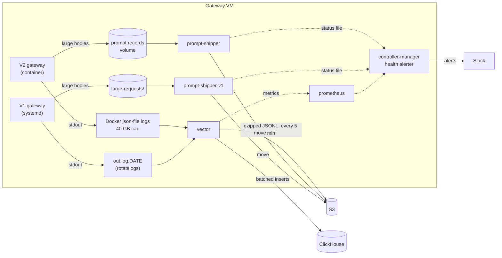

# Log Shipping

The gateway VM is a short-term buffer for two kinds of data. Both leave the VM
continuously, and the health alerter posts to Slack when either stops.

| Data | Written by the gateway as | Shipped by | Destination |
|---|---|---|---|
| Structured logs (JSONL, one line per event) | stdout | `vector` | S3 archive **and** ClickHouse |
| Large bodies (requests and responses of 2,000 bytes or more) | one file each | `prompt-shipper` (rclone) | S3, then **deleted locally** |

During the V1 to V2 transition the same two services ship both gateways' data.
V1 is one overlay file and one Vector file, removed together
([Retiring V1](#retiring-v1)).



## What runs

Both services are in `deploy/compose.yaml` behind the `log-shipping` profile, so
a laptop stack does not start them.

**`vector`** reads log files and never the Docker socket:

- V2: Docker's own `json-file` logs for the `inference-gateway` container
  (`deploy/log-shipping/vector/v2.yaml`). It keeps a read position, so after an
  outage it resumes where it stopped. Docker's retained log files are the backlog.
- V1: the `out.log.<date>` files (`v1.yaml`).
- Every line goes to the S3 archive unchanged.
- ClickHouse gets one row per line, parsed by `gateway_logs.vrl`. From V2 only
  the structured events are inserted: `RequestLog`, `ResponseLog` and
  `InferenceLog`. Access lines, application logs and tracebacks stay in the
  archive. From V1 every line is inserted, as before; one that is not JSON is
  flagged `unparsed`.
- Each sink has a 1 GB disk buffer and retries forever. A line is marked read
  only after both sinks have it, so a crash re-sends lines and never skips them.
  A re-sent line is an identical row, which `gateway_logs` collapses; the
  archive may hold it twice.

**`prompt-shipper`** runs `rclone move` every 5 minutes
(`deploy/log-shipping/ship-prompts.sh`):

- A file is uploaded with its MD5, which S3 checks against what it received,
  and only then deleted locally. A failed upload leaves the file for the next
  cycle. Oldest files go first.
- Files younger than 5 minutes are skipped: the gateway may still be writing them.
- It runs as uid 900, the gateway's user. The gateway writes these files `0600`
  in `0700` directories.

It is sized for V1's volume, about 250,000 files and 40 GB a day: it uploads
without listing the destination, and both services are capped at one CPU.

S3 layout (`inference-service-dev` / `inference-service-prod`). Everything is
filed by UTC day:

```text
v2/raw/logs/2026/11/10/20261110T141947Z-<uuid>.jsonl.gz
v2/raw/large-requests/2026/11/10/<request_id>.json
v2/raw/large-responses/2026/11/10/<request_id>.json

v1/raw/vector-logs/2026/11/10/20261110T141958Z-<uuid>.jsonl.gz
v1/raw/large-requests/<request_id>.json        (unchanged: flat)
```

`v1/raw/logs/out.log.<date>` (whole daily files) is not written by this stack.

## Retention on the VM

| Data | Local limit | When shipping is down |
|---|---|---|
| V2 structured logs (Docker `json-file`) | 80 files of 500 MB: 40 GB, over two weeks | Docker deletes the oldest file. Lines Vector had not read are lost. |
| V2 large bodies | 14 days | A file older than 14 days is deleted **even if it never uploaded**. Not in a shipper's first day, and not while it is still working off a backlog. |
| V1 structured logs | none (V1's own rotation) | Nothing is deleted. |
| V1 large bodies | none | Nothing is deleted. The directory grows. |
| Vector disk buffers | 1 GB per sink | Vector stops reading until the sink recovers. |
| Other containers' logs | 3 files of 10 MB | Not shipped. |

The 40 GB figure assumes about 2.5 GB of gateway log per day (V1 writes 1.8 GB;
Docker's JSON wrapping adds about a third). Change `max-file` on
`inference-gateway` in `deploy/compose.yaml` if the real volume differs; the
limit is by size, so a busier gateway has a shorter window.

!!! warning "Large bodies fill the disk long before 14 days"
    At 40 GB a day, a stalled prompt shipper fills a 250 GB disk in about four
    days. The 14-day limit bounds how old a file can get, not how much disk is
    used. The backlog alert (warning at 1 hour, critical at 1 day) and the
    existing disk alerts (70/80/90%) are the early warning.

## Alerts

`check_log_shipping` in the health alerter
(`health_alerter/log_shipping.py`) runs every two minutes where
`FIRST_LOG_SHIPPING__PROMPT_SHIPPERS` is set (`.env.prod` sets it).

| Alert | Meaning | Look at |
|---|---|---|
| Vector is down / no `vector` target | The container is not running, or failed to start | `docker compose logs vector` |
| Sink has sent nothing for 15m | ClickHouse or S3 is refusing or unreachable | the same; the sink retries by itself |
| Disk buffer over 50% full | A long sink outage. At 100% Vector stops reading | the sink's alert |
| Dropped events / errors | Lines discarded, or a file could not be read | `docker compose logs vector` |
| No V2 lines for 30m | Vector is not reading the gateway's Docker logs | `DOCKER_ROOT_DIR`, the gateway's `logging:` |
| Prompt shipper: not running | No status file, or none for 45 minutes | `docker compose ps prompt-shipper` |
| Prompt shipper: failing (warn) | 3 failed cycles, or a file waiting over 1 hour | `docker compose logs prompt-shipper` |
| Prompt shipper: backlog (crit) | A file has waited over 1 day. Deletion is at 14 days | the same |
| Prompt shipper: deleted files | The 14-day limit removed files that never uploaded | restart the service to clear the alert |

The Vector rules are PromQL in `log_shipping.py`; paste one into Prometheus
(<http://127.0.0.1:9090>) to see what it sees. If Prometheus itself is down the
check fails, and a failed check is also posted to Slack.

## Setup

1. **Settings.** Copy `.env.log-shipping.example` to `.env.secret.log-shipping`
   and fill it in: the bucket, its read-write key pair, and the ClickHouse
   password. Only `vector` and `prompt-shipper` read it. Put the two CA
   certificates it names in `pki/log-shipping/`:

        pki/log-shipping/s3-ca.pem           # the Camel S3 endpoint's CA
        pki/log-shipping/clickhouse-ca.crt   # the ClickHouse CA

2. **`.env`** on the host:

        COMPOSE_PROFILES=log-shipping
        # Only if `docker info -f '{{.DockerRootDir}}'` is not /var/lib/docker
        # (snap installs use /var/snap/docker/common/var-lib-docker):
        DOCKER_ROOT_DIR=/var/snap/docker/common/var-lib-docker

    While V1 runs, also add `deploy/compose.v1-logs.yaml` to `COMPOSE_FILE`.
    It reads `/home/webportal/raw-prod-logs` (override with `V1_LOG_DIR`).

    `make prod-*` sets the profile and both overlays itself; the systemd unit
    and plain `docker compose` read `.env`.

3. **Health check.** Prod has it on (`.env.prod`). On another host, give
   `controller-manager` `FIRST_LOG_SHIPPING__PROMPT_SHIPPERS=["v2"]`.

4. **Start.** `make prod-init` once (creates `vector_data_prod`), then
   `make prod-up`. The first start recreates `inference-gateway`, because its
   log driver changes to `json-file`.

5. **Verify.**

        ./scripts/verify-log-shipping.sh

    It moves a test prompt file to S3, sends a marked request (a 404) through
    the V2 gateway, and waits for ClickHouse and S3 to accept it (about 7 minutes).
    On a test host add `--write-v1-line` to push a marked line through the V1
    path too; on prod it waits for real V1 traffic instead.

!!! note "Testing a Vector config change"
    Vector 0.58 does not expand `${VARS}` in its config. Values come from
    `vector/settings.sh`, a Vector secrets backend that reads the container's
    environment. `vector validate` does not run it, so check a change by
    restarting the service and reading `docker compose logs vector`.

## Taking over from the standalone Vector

A Vector container outside this repo (podman, FIRST-analytics `vector.yml`)
ships V1 structured logs to ClickHouse today. Hand over with an overlap, never
a gap:

1. Bring up this stack with the V1 overlay and run the verify script. The new
   Vector starts at the end of the current V1 file, so both Vectors now send
   the same new lines.
2. Stop the old one and disable its unit, as its owner:

        systemctl --user disable --now first-analytics-vector.service
        podman rm -f first-analytics-vector

3. Disable the host cron that runs `rclone move` on V1 large requests:
   `prompt-shipper-v1` replaces it.

The overlap produces duplicate rows for those minutes. `gateway_logs`
collapses identical lines, as it already does for Vector's redeliveries.

## Retiring V1

1. Delete `deploy/compose.v1-logs.yaml` and `deploy/log-shipping/vector/v1.yaml`.
2. Remove the overlay from `COMPOSE_FILE` in `.env` and from `PROD_COMPOSE` in
   the `Makefile`.
3. `make prod-up`, then `docker compose up -d --remove-orphans` to remove the
   `prompt-shipper-v1` container.

Before step 1, check the V1 directory is empty of unshipped files:
`docker compose logs prompt-shipper-v1 --tail 5`.
